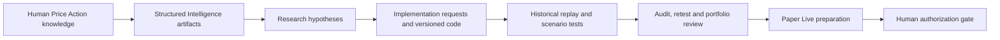

# Architecture

The portfolio site is a separate static artifact: approved aggregate CSVs load in the browser, custom JavaScript calculates filtered P&L summaries and renders SVG charts. It has no trading connection.
