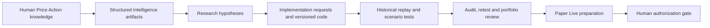

# Architecture

The portfolio site is a separate static artifact. Approved aggregate CSVs feed browser-side portfolio summaries and SVG charts. The historical replay loads its sanitized candle session separately from the outcome payload; the position model reveals the outcome only when playback reaches the exit. Lightweight Charts is bundled locally for the candle view. This presentation is not connected to a trading executor, broker, account or live market feed.
